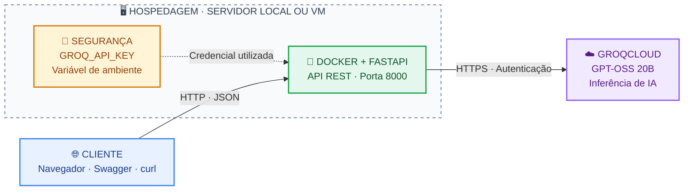

# Laboratório Docker + GroqCloud (FastAPI) 04/11/2026

> Disponível no: [GITHUB](https://github.com/lanverly/lab-groq-docker)
> https://github.com/lanverly/lab-groq-docker

## Objetivos

- Diferenciar imagem Docker de contêiner.
- Publicar uma API REST local a partir de um contêiner.
- Consumir um serviço de IA **externo** por HTTPS.
- Configurar credenciais por variável de ambiente.
- Observar JSON, logs, HTTP e consumo de tokens.

## Pré-requisitos

- Docker Engine com plugin `docker compose`.
- Conectividade de saída para `https://api.groq.com` (HTTPS/443).
- Chave válida criada em https://console.groq.com/keys (verifique cotas e eventual cobrança).

## Arquitetura do laboratório


## Executando

```bash
cp .env.example .env
# Edite o arquivo .env e substitua cole_sua_chave_aqui pela chave real.
docker compose up --build -d
docker compose ps
```

Abra: http://localhost:8000/docs

Teste a saúde local:

```bash
curl http://localhost:8000/health
```

Envie uma requisição (requer chave Groq válida e acesso à internet):

```bash
curl -sS -X POST http://localhost:8000/perguntar \
  -H 'Content-Type: application/json' \
  -d '{"pergunta":"Qual a diferença entre VM e container? Responda em 3 frases."}'
```

Inspecione logs e contêiner:

```bash
docker compose logs -f api
docker compose ps
docker stats
```

Encerre:

```bash
docker compose down
```

## Atenção

- O modelo **não está dentro do Docker**. O Docker hospeda apenas a aplicação FastAPI.
- O endpoint `/health` verifica apenas o serviço local; não testa autenticação nem conectividade com a Groq.
- `127.0.0.1:8000:8000` restringe a API ao próprio computador.
- Não compartilhe o arquivo `.env` nem faça commit da chave.
- Em produção, adicionar autenticação, autorização, rate limiting, monitoramento e gestão de segredos; o exemplo é didático.
- As dependências estão delimitadas por faixas de versão para facilitar o workshop; para builds reprodutíveis, trave versões exatas com lockfile.

## Roteiro de execução

1. Desenhar o fluxo: cliente → FastAPI (Docker) → GroqCloud (HTTPS).
2. Explicar Dockerfile, imagem e build.
3. Executar `docker compose up --build -d` e mostre `docker compose ps`.
4. Testar `/docs`, `/health` e `POST /perguntar`.
5. Comparar `docker stats` com o processamento remoto do modelo.
6. Pedir uma mudança no prompt ou validar um erro 422, e discutir segurança da chave.

## Desafios aos alunos

- Rejeitar perguntas com mais de 100 caracteres.
- Alterar o `GROQ_MODEL` (para um modelo ativo acessível na conta) sem reconstruir a imagem, reiniciando o contêiner.
- Demonstrar erro HTTP 422 com JSON inválido para o modelo de entrada.
- Explicar por que o modelo continua funcionando sem GPU local.

## Extra

Comparação dos códigos HTTP

|Código|Significado|
|-|-|
|200|Requisição processada com sucesso|
|400|Requisição inválida|
|401|Autenticação ausente ou inválida|
|404|Recurso não encontrado|
|422|Conteúdo não atende às regras de validação|
|500|Erro interno do servidor|
